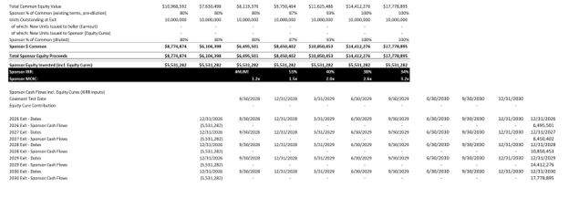
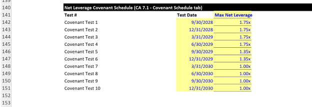
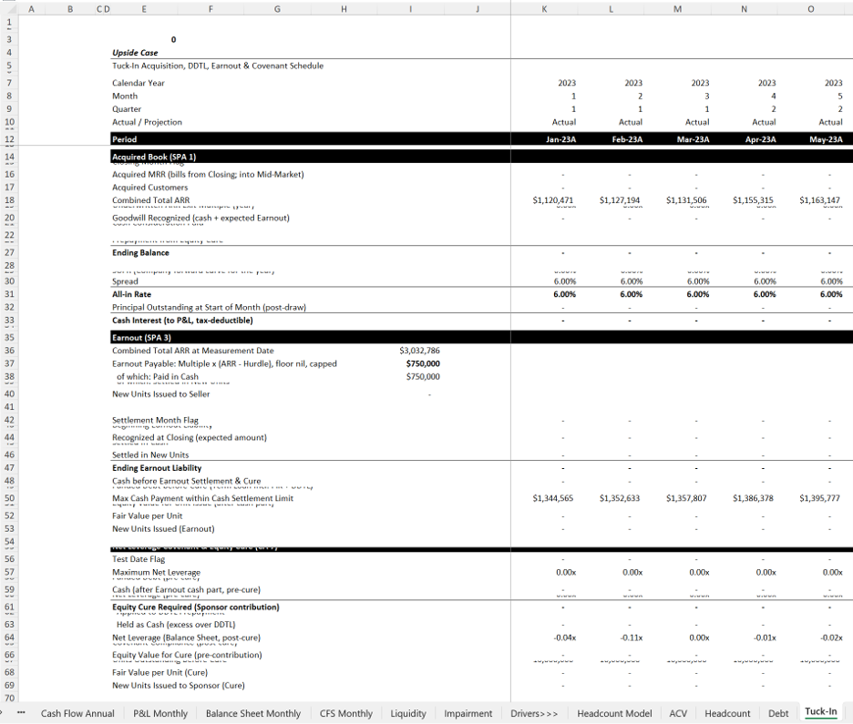
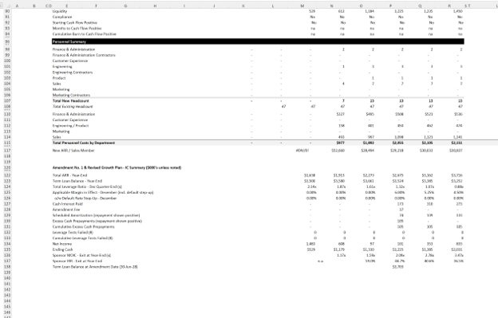
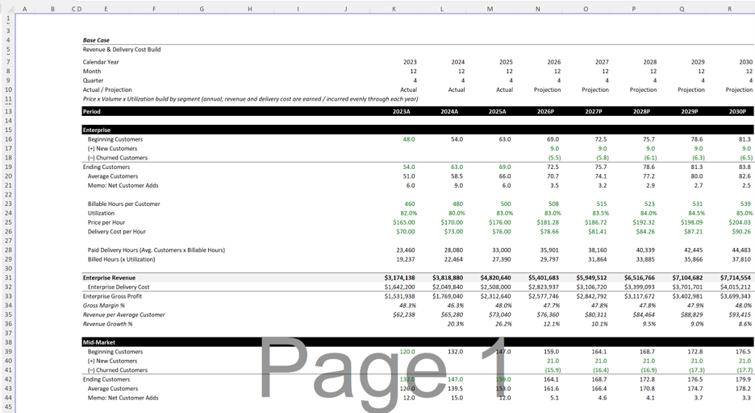

# Waverly: Spreadsheet RL Tasks

Waverly was founded by a former Finance professional who worked for 5 years at Goldman Sachs and TPG (top PE firm). For the past 3 years, Waverly has built AI automations for investment workflows, with a focus on Excel automations. Waverly therefore has extensive experience working with AI Agents on spreadsheet tasks, and has a deep repository of real-world spreadsheets that challenge frontier models.

## TLDR

- **161 graded tasks across 14 task families** on two real-style (anonymized) PE LBO models. Orion: 35 tabs, ~72,000 formulas. Kestrel: 19 tabs, ~43,000 formulas. Both run three operating cases and carry the pre-existing defects a real deal model has.
- **Claude Opus 5.5 (Claude Code, medium effort) passes 24% (39/161).** The pass rate falls with difficulty: 85% on Easy, 38% on Medium, 13% on Hard.
- **The math isn't the problem.** Agents got **84% of graded figures right**. They fail on what makes a model usable: poor formatting, incorrect assumptions, unintended downstream impacts from edits, and stale logic / tabs kept in the new build.
- **One formatting rule is partly an artefact of our harness, so we report every pass rate both ways.** Agents edit with openpyxl, which moves cell contents without their row heights when rows are inserted; Excel moves both. Content can land on a thin spacer row and become unreadable ("squished"). With that rule taken out, the pass rate is 27% (44/161). See Results.
- This reflects the frontier of financial modeling today. In our experience, Agents are excellent at math and core financial modeling. But they do poorly at returning quality outputs that real professionals expect. Formatting and conventions do matter significantly. E.g. You cannot submit an unreadable model for Investment Committee, even if the numbers are mostly correct.

|                               | Overall          | Easy        | Medium      | Hard         |
| ----------------------------- | ---------------- | ----------- | ----------- | ------------ |
| Pass rate                     | **24%** (39/161) | 85% (11/13) | 38% (14/37) | 13% (14/111) |
| Without the squished-row rule | **27%** (44/161) | 85% (11/13) | 38% (14/37) | 17% (19/111) |

<!-- IMAGE: one-line chart, pass rate vs. share of figures right per category. Optional. -->

## Tasks

Fourteen task families on two model templates (eight on Orion, six on Kestrel), grouped into seven categories by what they test. Each family has 3-27 levels (Easy / Medium / Hard and variants). A level adds work (more instruments, more tabs touched, less said about where), not a different skill. The Kestrel families fit the same categories: its conversions go furthest, replacing the software company with a different business (equipment rental, a distributor, a contractor, clinics, a payments processor, consumer memberships), each with its own income statement and balance sheet lines.

| Category                                          | What the agent has to do                                                                                                                                                                                                                                                    |
| ------------------------------------------------- | --------------------------------------------------------------------------------------------------------------------------------------------------------------------------------------------------------------------------------------------------------------------------- |
| **Revenue build restructure**                     | Re-cut a 4-segment revenue build into 2–3 new segments with new retention assumptions, and carry it through to the IC tabs                                                                                                                                                  |
| **Model type conversion (e.g. SaaS to Services)** | Replace subscription revenue with price × volume × utilization; strip what no longer applies (commissions, MRR waterfalls, retention metrics)                                                                                                                               |
|                                                   | Convert to a consumer app: a users bridge, ARPU, gross-to-net, paid acquisition; Hard adds annual-plan deferred revenue, devices, app-store fees                                                                                                                            |
| **P&L / cost structure restructure**              | Keep half of a person-by-person headcount roster, convert the other departments to % of revenue, and rewire the P&L and IC tabs                                                                                                                                             |
| **Error audit & repair**                          | Find and fix the template's real calculation errors (interest, logo double count, copy-error inputs) and leave the rest alone                                                                                                                                               |
| **Capital structure change**                      | Preferred equity, management pools, seller notes with PIK, dividend recaps, warrants, revolvers, covenant amendments, a segment sale                                                                                                                                        |
| **Add-on acquisition**                            | A mid-hold add-on through the template's own mechanics: acquired customers, overlap, incremental debt with a cash sweep, earnouts, a 4th case                                                                                                                               |
| **Revenue model rewiring**                        | Replace how revenue works mid-hold (usage pricing, retention by customer age, a distributor, three-year contracts, named top accounts, a JV, a free tier) and carry it through every link that reads it; some levels add a financing or cost term defined on the new figure |

**What a brief looks like** (07 Hard-7, abridged). It reads as a note to a junior analyst:

> We've signed to buy a channel competitor mid-hold, and I need the add-on in our existing model before IC. Apart from what the integration plan below sets, our operating plan and the existing term loan's terms and accounting don't change. […] Closing is 1 July 2028. The target sells only through partners, to enterprise accounts: 75 customers paying $45,000 of MRR in total at closing. […] 15 of the 75 are already our direct enterprise customers […] On the last day of each fiscal quarter, beginning 30 September 2028, if the Total Leverage Ratio exceeds 1.80 to 1.00, the Borrower shall prepay the incremental term loan by 50% of the amount by which its cash exceeds $500,000 […]
>
> **For IC, in each case:** ARR by segment and Total ARR at Dec-28 and Dec-30; […] the sponsor's MOIC for the 2028 and 2030 exits and its IRR for the 2030 exit.

## Results

One run per level. Claude Opus 5.5 (1M context), medium effort, up to 200 turns.

**Harness.** We used native Claude Code out of the box, with no custom tools. To edit the spreadsheets, it often uses Python tools such as openpyxl. To grade, we recalculate each finished workbook in our own spreadsheet execution engine, built on top of Univer. We don't include that engine in the grader, since most labs have their own in-house logic for evaluating spreadsheet agents.

**By category.** The last column removes the squished-row rule (see the note below the table).

| Category                         | Runs    | PASS   | Pass rate | Pass rate without the squished-row rule |
| -------------------------------- | ------- | ------ | --------- | --------------------------------------- |
| Revenue build restructure        | 14      | 8      | 57%       | 57% (8)                                 |
| Model type conversion            | 71      | 8      | 11%       | 11% (8)                                 |
| Error audit & repair             | 11      | 8      | 73%       | 73% (8)                                 |
| P&L / cost structure restructure | 6       | 2      | 33%       | 33% (2)                                 |
| Capital structure change         | 22      | 6      | 27%       | 41% (9)                                 |
| Add-on acquisition               | 18      | 5      | 28%       | 28% (5)                                 |
| Revenue model rewiring           | 19      | 2      | 11%       | 21% (4)                                 |
| **All**                          | **161** | **39** | **24%**   | **27% (44)**                            |

**By template**

| Template | Runs | PASS | Pass rate | Pass rate without the squished-row rule |
| -------- | ---- | ---- | --------- | --------------------------------------- |
| Orion    | 79   | 21   | 27%       | 33% (26)                                |
| Kestrel  | 82   | 18   | 22%       | 22% (18)                                |

**About the squished-row column.** Both models put thin 5pt spacer rows between blocks. When an agent inserts or deletes rows with openpyxl, the contents shift but each row position keeps its old height, so real content can land on a 5pt row. Excel would move the height with the row, and a lab running its own spreadsheet engine may never see this. We keep the rule in the grader (a run fails above 15 squished rows) and show the result without it. The column counts a run as passing when everything else passes; it keeps the reviewer's recorded score, which also marked those rows down, so it is a floor.

- **Fails most where the business model changes.** The conversions pass 8 of 71 across both templates (0 of 12 on Orion). A major factor is the Agent must rewire every downstream formula, if you remove say the revenue build. This is consistent with our observation when using Agents for complex real-world financial modeling.
- **Where the change is well-specified, the numbers are right but the Agent can fail on modeling convention.** Capital structure and add-on acquisitions get 94–97% of figures right, but pass only 28–33%. Most of those failures are poor modeling practices and formatting, not math.

## Grader / Rubric

The agent writes no answer file. It saves the workbook, and a grader reads it like a reviewer would.

| Part            | Points | What it checks                                                                                                                                                    | Fails the run when                                                                                                                                                                                  |
| --------------- | ------ | ----------------------------------------------------------------------------------------------------------------------------------------------------------------- | --------------------------------------------------------------------------------------------------------------------------------------------------------------------------------------------------- |
| **Outputs**     | 30     | Deterministic. Every figure the brief asks for, wherever an IC reader would see it, in all three cases                                                            | Any figure is wrong in any case                                                                                                                                                                     |
| **Conventions** | 25     | Deterministic. The model still calculates monthly and was edited in place; squished rows (-2 each); fonts match each tab's convention                             | The monthly build structure is gone, the workbook was rebuilt from a script, the judge finds a parallel build (2 tabs doing the same thing), or more than 15 content rows are squished (unreadable) |
| **Tie-outs**    | 15     | Deterministic. Figures that must agree across tabs: the balance sheet balances; revenue, EBITDA and ARR agree on every IC tab; every ARR bridge ends at Total ARR | Any tie-out breaks                                                                                                                                                                                  |
| **Judge**       | 30     | LLM reviewer. A judge evaluates the output workbook for qualitative structure, integrity, summary tabs, instruction following, etc.                               | It scores below 50                                                                                                                                                                                  |

Two more gates fail the run: a new error cell (`#REF!`, `#DIV/0!`) the template didn't have, and (only on certain conversion tasks) leftover rows the brief asked to remove.

**How a figure is found.** The answer key holds numerical values only. A read-only "mapper" LLM finds each figure in the finished workbook without seeing the expected value; deterministic code then does every comparison. Every pick is logged, so a disputed grade can be checked by hand.

**How keys are built.** Where a task changes the plan or adds to the model, a short script makes the same changes in a copy of the model and recalculates it, so every keyed figure comes from the model itself. Where a task replaces the business, the operating figures are computed by an independent Python calculation and checked against an Agent reference build (another Agent); cash, debt and returns come from that build. Where a brief fairly allows two readings, the key accepts both.

## Where agents fail

The breakdown below is from the first 82 runs, all on Orion (62 failures); the Kestrel runs fail in the same ways and have not been classified one by one yet. A run can fail for more than one reason, so the shares add up to more than 100%.

| Failure mode                                                                  | Failed runs | Share of failures |
| ----------------------------------------------------------------------------- | ----------- | ----------------- |
| Poor formatting (content rows squished to 5pt or hidden, mismatched fonts)    | 36          | 58%               |
| Incorrect assumptions (a figure the brief or the case settles, entered wrong) | 11          | 18%               |
| Unintended downstream impacts                                                 | 12          | 19%               |
| Stale logic / tabs kept in new build                                          | 12          | 19%               |
| Numbers don't tie (e.g. a summary tab doesn't match the build)                | 14          | 23%               |
| Incorrect oversimplification (e.g. monthly build converted to annual)         | 3           | 5%                |
| Audit fix incomplete                                                          | 3           | 5%                |
| Other (a template error surfaced on an IC tab, small numeric drift)           | 4           | 6%                |

### 1. Poor formatting

We've noticed that formatting is a real shortcoming consistently across these tasks. Often, we've anecdotally heard that Agent-created models look like they weren't "created by humans". For example, new content is often bolted onto the very end of existing templates, e.g. at the bottom of existing builds. With poor formatting styles applied.

Another example: Real models can use thin 5pt spacer rows between blocks. Agents insert new rows next to them. In our tasks, we often see edited rows be 5pt height, which is unreadable to an actual investment professional. An agent that checks its own work should catch these errors. Part of this is specific to our harness: openpyxl moves cell contents without their row heights, where Excel moves both, which is why Results also shows pass rates with this rule removed.

Note: In an experiment, we added the following prompt: "Build new items into the model's existing sections, formatted like their neighbours". In other words, format better and don't just add on new content to the very bottom of tabs. Across 16 tasks, formatting failures dropped from 7 to 1 and the pass rate rose from 24% to 47%. However, substantive failures barely moved (7 → 6): Agents swapped formatting mistakes for quieter ones, such as repurposing the template's Adjusted EBITDA row and silently moving every link to it. Ultimately, we left this out from the prompts as we think real-world Analysts would not need such instructions. In other words, we think SOTA Agents should have these capabilities built in natively.

### 2. Incorrect assumptions

The prompt states every fact that moves a number, and the template runs three cases side by side. Agents still enter some of those figures wrong: they carry Base-case values into the other cases, or do the opposite of what a stated business fact says.

- **02 Medium-3:** Jul–Dec 2025 costs frozen to Base, which moved Downside and Upside returns.
- **04 Hard:** 2025 opex assumptions swapped to Base in every case.
- **02 Medium and Medium-2:** built a sales commission line although the brief says "the business pays no sales commissions". 05 Medium-2 did the opposite: zeroed the commissions the brief said stay.

### 3. Unintended downstream impacts

There are real defects in our model template, which is representative of real-world models. Sometimes, Agents spot the template's defects and can't leave them alone. The brief says "our operating plan doesn't change"; the agent fixes a quirk next to the change it was asked for, and the fix cascades through cash, covenants and returns. We view this as a real failure, as often real-world models have quirks built into them in order to solve some task, which gets maintained over time.

- **07 Hard-7 and Hard-11, 08 Cohort-retention and Product-led:** 2 of the template's revenue retention segments are cross-wired. Agents rewired them to their "own" rows, which rewrote the existing plan. In Hard-7, Dec-28 leverage fell from 1.83x to 1.77x, below the 1.80x sweep trigger, so the cash sweep, loan balance, cash and returns all moved (14 of 54 figures wrong).
- **06 Hard-4:** re-booked the term loan's PIK through P&L interest against the brief; 25 of 33 figures wrong and two Events of Default in Base.

### 4. Stale logic / tabs kept in new build

Instead of adapting the template's logic (which would be best practice), the agent builds a new, duplicate tab and leaves the old one running. This is poor practice, as the model becomes bloated with duplicate (and dead) tabs.

- **05 Hard:** a new Opex_Build roster beside the legacy Headcount Model, which still calculates Co-Founder, CEO and Engineer salaries.
- **06 Hard-6:** the template's 2.25x / 2.0x covenant kept and relabelled "legacy memo". It still shows "Yes" compliance next to the amended covenant test, which fails.
- **07 Hard-8-v2:** deal terms appended at the bottom of Assumptions, the add-on in a new tab, the template's sponsor ownership step-up left running beside the new units. Model_Output became a patchwork of 10pt and 12pt blocks.

### 5. Incorrect oversimplification (monthly build converted to annual)

Faced with complex changes, sometimes Agents simply delete the existing logic. E.g. Delete the complex monthly build with 100+ column, and replace it with an annual schedule with just 8 years. In task family 02, this occurred frequently. This is obviously wrong, as the details of the monthly schedules were deleted completely.

## Limitations

This is a first look, not a leaderboard.

- **One run per level, one model, one effort setting, one harness.** We haven't measured run-to-run variance or compared models due to our limited compute
- **The grader includes minor LLM steps** A LLM judge is 30% of our rubric, though we think this is an essential component of the rubric; while you can have many ways to model the same math, _quality_ does matter, which is subjective. We also have a "mapper" step in our grading logic, which helps reconcile the template's golden cells with the Agent's output (e.g. Agent may have shifted rows around)

## What's in each task

- The brief, the template workbook and any data-room files
- The answer key: values per case, tolerances, and the tie-outs, with "X, NOT Y" descriptions for each figure
- An accepted reference build and an independent calculation script that agree on every keyed value
- The grader and a per-component score
- Full agent transcripts and the graded workbook with every changed cell highlighted
